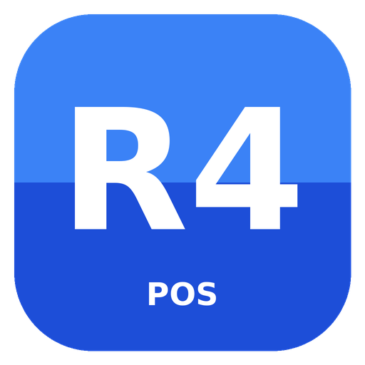

# ConfeccionesR4 POS

**Sistema de punto de venta desarrollado a la medida para Confecciones R4**

Aplicación de escritorio para Windows · 100 % offline · un solo ejecutable

---

ConfeccionesR4 POS reúne en un solo programa la operación diaria de la tienda: venta en
mostrador, inventario con etiquetas de código de barras, separados con abonos, cambios de prenda,
caja con arqueo ciego, reportes de gestión y un historial de documentos que no se puede alterar.

Es un software **de uso exclusivo de Confecciones R4**. No es un producto comercial ni está
pensado para instalarse en otros negocios.

## Funciones principales

| Módulo | Qué hace |
|---|---|
| **Dashboard** | Ventas netas, utilidad, métodos de pago y prendas más vendidas del día y del mes |
| **Vender** | Escaneo, búsqueda, descuentos, pago en efectivo, Nequi, Bre-B, datáfono o mixto |
| **Documentos** | Historial de tiquetes, reimpresión, devoluciones parciales, anulaciones y cambios de prenda |
| **Separados** | Reserva de prendas con abonos, entrega y anulación con devolución |
| **Inventario** | Productos, importación/exportación Excel, etiquetas, conteo físico con escáner |
| **Caja** | Apertura, entradas y salidas, aperturas de cajón, arqueo ciego y cierre interno |
| **Reportes de gestión** | Mercancía quieta, ventas por categoría/talla/color/marca, comparativo y sugerido de compra |
| **Ajustes** | Empresa, impresoras, etiquetas, seguridad, datos, nube y actualizaciones |

## Requisitos

- Windows 10 u 11 de 64 bits.
- Impresora térmica de 80 o 58 mm (tiquetes) y, opcionalmente, impresora de etiquetas.
- Lector de código de barras USB (funciona como teclado).
- Conexión a internet solo para actualizaciones y respaldo en la nube; la venta no la necesita.

## Instalación rápida

1. Descargar `Instalador_ConfeccionesR4_v1.0.exe` desde la sección **Releases**.
2. Ejecutarlo en el equipo de la tienda y seguir el asistente.
3. En el primer inicio, el asistente de configuración guía en cinco pasos: datos del negocio,
   numeración de los tiquetes, cajero, impresora e inventario inicial.

Si Windows muestra una advertencia de SmartScreen: **Más información › Ejecutar de todas formas**.

## Documentación

| Documento | Contenido |
|---|---|
| [Funcionamiento del sistema](docs/FUNCIONAMIENTO.md) | Módulos, flujo de venta, caja, separados y reglas de negocio |
| [Operación diaria](docs/OPERACION.md) | Tareas frecuentes, atajos de teclado y cómo corregir errores |
| [Hardware](docs/HARDWARE.md) | Impresora de tiquetes, impresora de etiquetas, cajón y lector |
| [Datos, respaldos y seguridad](docs/DATOS_Y_SEGURIDAD.md) | Dónde se guarda todo, respaldos, auditoría y facturación |
| [Instalación y actualizaciones](docs/INSTALACION.md) | Instalador, actualizaciones firmadas y publicación de versiones |
| [Desarrollo](docs/DESARROLLO.md) | Estructura del código, entorno local, pruebas y compilación |

## Privacidad

El repositorio contiene únicamente el código del programa. Los datos de la tienda (ventas,
inventario, clientes, NIT, dirección y configuración) viven solo en el equipo de la tienda y
en sus respaldos, nunca en este repositorio.

## Licencia

Software propietario. © 2026 maiwxzs. Desarrollado para uso exclusivo de Confecciones R4.
Ver [LICENSE](LICENSE).

---

<i>hecho con dedicación por maiwxzs</i>

